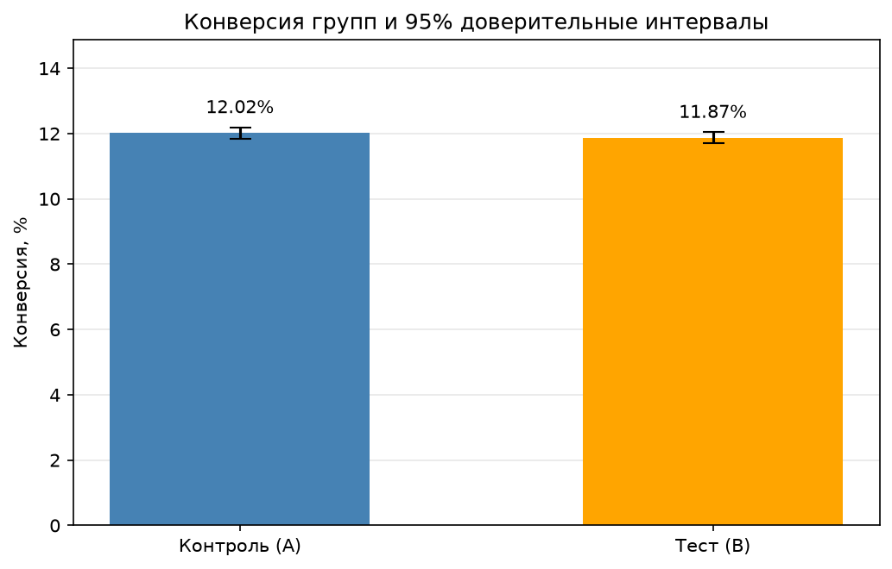
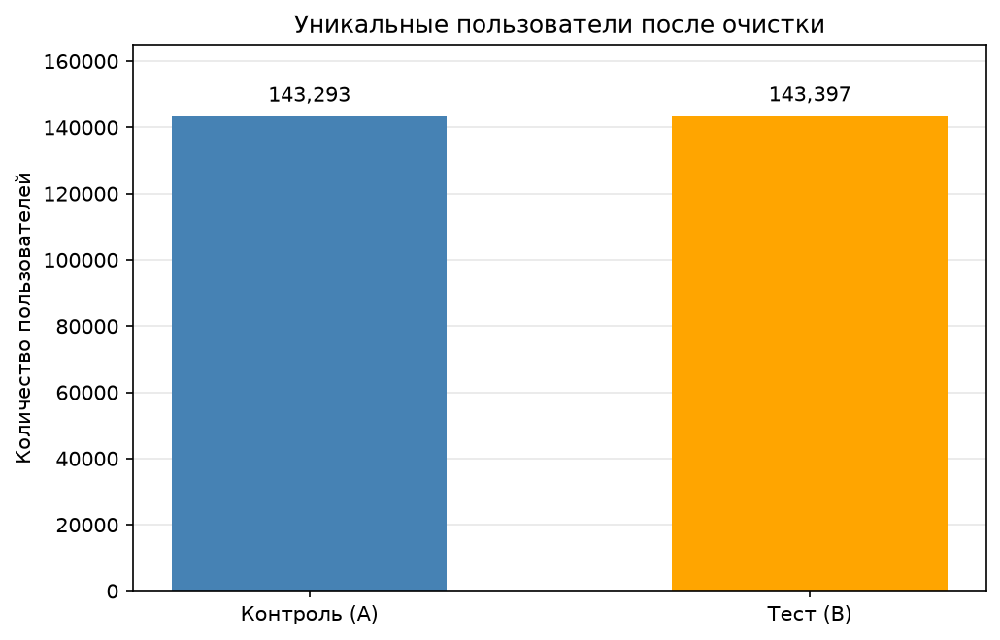
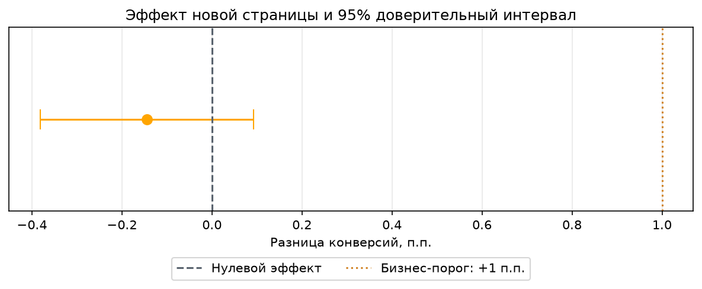

# A/B Testing Analysis

Анализ результатов A/B-теста старой и новой версий страницы:
подготовка данных, сравнение конверсий, проверка гипотез
и оценка практической значимости эффекта.

## Инструменты

Python · Pandas · NumPy · SciPy · Matplotlib · Seaborn · Jupyter

## Данные

[A/B Testing — Kaggle](https://www.kaggle.com/datasets/zhangluyuan/ab-testing):
294 478 записей о событиях, 290 584 уникальных пользователя.
Учебный датасет сравнения старой и новой страниц.

Источник: публичный датасет, опубликованный пользователем zhangluyuan на Kaggle.

Поля: `user_id`, `timestamp`, `group`, `landing_page`, `converted`.

- Контрольная группа A: `control`, старая страница `old_page`.
- Тестовая группа B: `treatment`, новая страница `new_page`.
- Основная метрика: доля пользователей, совершивших конверсию.

## Бизнес-вопросы

- Повышает ли новая страница конверсию?
- Есть ли статистически значимая разница между группами?
- Каков абсолютный и относительный размер эффекта?
- Какой диапазон изменения конверсии совместим с данными?
- Превышает ли улучшение условный бизнес-порог +1 п.п.?
- Поддерживают ли результаты внедрение новой версии?

## Основные результаты

| Показатель                            |                Значение |
| ------------------------------------- | ----------------------: |
| Уникальные пользователи после очистки |                 286 690 |
| Пользователи контрольной группы A     |                 143 293 |
| Пользователи тестовой группы B        |                 143 397 |
| Конверсии в контрольной группе A      |                  17 220 |
| Конверсии в тестовой группе B         |                  17 025 |
| Конверсия контрольной группы A        |                12,0173% |
| Конверсия тестовой группы B           |                11,8726% |
| Абсолютный эффект B − A               |            −0,1447 п.п. |
| Относительное изменение конверсии     |                  −1,20% |
| p-value двустороннего z-теста         |                0,232288 |
| 95% доверительный интервал эффекта    | [−0,3821; +0,0927] п.п. |

- Конверсия новой страницы численно ниже, однако статистически значимая
  разница при α = 0,05 не обнаружена. Результат не доказывает
  равенство конверсий и не подтверждает устойчивое ухудшение.
- Доверительный интервал включает нулевой эффект. Его верхняя граница
  ниже выбранного бизнес-порога +1 п.п.: данные не поддерживают
  улучшение такого размера.
- При условном распределении 50/50 значимый дисбаланс после очистки
  не обнаружен: p-value SRM = 0,8460 при пороге 0,01.
  Это не доказывает корректность рандомизации.
- Из анализа исключены 7 788 строк, соответствующие 3 894 пользователям;
  в очищенной выборке каждый пользователь представлен один раз.

**Рекомендация:** не внедрять новую страницу ради роста конверсии
на +1 п.п. на основании текущего анализа. Пересмотреть дизайн страницы
и, если появится новая гипотеза, спланировать отдельный эксперимент.
Вывод условен и относится к очищенной учебной выборке.

## Визуализации

Графики создаются при запуске ноутбука; для отображения на GitHub
добавьте полученные файлы из `images/` в репозиторий.







## Методика и ограничения

- Единица анализа — уникальный пользователь.
- Полные дубликаты удалены при допущении о повторной записи событий.
- Пользователи с пропусками или некорректными значениями,
  пересечением групп, неправильной страницей или несколькими
  различными событиями исключены целиком.
- Очистка сопровождается журналом исключений и сравнением потерь по группам;
  исключения могут изменить состав выборки.
- Используется двусторонний z-тест двух независимых долей при α = 0,05.
- 95% доверительный интервал разницы рассчитывается нормальным приближением;
  применимость приближения проверяется в ноутбуке.
- Плановое распределение 50/50 неизвестно и принято условно для диагностики SRM.
- Бизнес-порог +1 п.п. задан для учебного анализа; это не MDE,
  рассчитанный по мощности эксперимента.
- Полного журнала рандомизации и описания окна конверсии нет;
  независимость наблюдений и корректность назначения полностью не проверяются.
- Данных о стоимости внедрения и доходе нет;
  экономическая целесообразность отдельно не рассчитывается.
- Датасет учебный; выводы не относятся к эксперименту реальной компании.

Подробные решения и ограничения описаны в `ab_test_analysis.ipynb`.

## Запуск

1. Скачайте датасет по ссылке выше и распакуйте архив.
2. Поместите `ab_data.csv` в папку `data/`.
3. Создайте окружение и установите зависимости из основной папки проекта:

   ```bash
   python3 -m venv .venv
   source .venv/bin/activate
   python -m pip install -r requirements.txt
   ```

4. Откройте `ab_test_analysis.ipynb` в VS Code с расширениями Python и Jupyter.
5. Выберите ядро `.venv` и выполните все ячейки по порядку.
6. Сохраните ноутбук с результатами и добавьте созданные графики в репозиторий.
